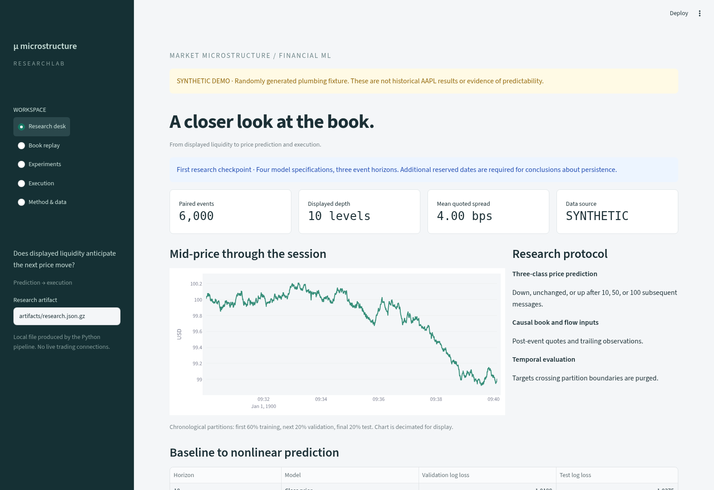

# Market Microstructure & Order Book Prediction

A reproducible Python research project investigating whether displayed liquidity and order flow anticipate short-horizon mid-price changes—and whether predictions survive spread crossing, fees, and event latency.

The Streamlit research lab provides five views: **Research desk**, **Book replay**, **Experiments**, **Execution**, and **Method & data**. All metrics are calculated by the research pipeline and loaded from an inspectable JSON artifact. This repository implements the workflow shown in the original [research site](https://prasiddh-microstructure-lab.grittygourd2.chatgpt.site/); it is a new implementation, not a recovered source export.



See the [execution view](docs/images/execution.png) and [generated example readout](docs/example-readout.md). Both use synthetic data.

## Run in five minutes

Python 3.11+ (validated on 3.12). From the repository root:

```bash
python -m venv .venv
source .venv/bin/activate
python -m pip install -e '.[dev]'
python -m orderbook.research --demo --output artifacts/research.json.gz
streamlit run app.py
```

**The demo is synthetic.** Its price innovations are independent of displayed depth. It validates the implementation and interface; it is not historical AAPL data and supplies no evidence of a tradable market signal. The app displays a persistent synthetic-data warning. No credentials or external services are required for this workflow.

## Use historical data

The historical input format is one pair of headerless LOBSTER message and order-book CSVs from the same instrument, date, and depth. Preserve their original filenames and row order in one directory.

```bash
python scripts/download_sample.py
python -m orderbook.research --data data/raw/aapl-2012-06-21 --output artifacts/research.json.gz
streamlit run app.py
```

The downloader targets the public AAPL 2012-06-21 ten-level sample at [LOBSTER](https://lobsterdata.com/info/DataSamples.php). It preserves TLS verification, refuses existing file overwrites, records the archive SHA-256, and accepts an independently sourced `--sha256` if available. Availability of the remote archive has **not** been verified in this environment: its domain is currently blocked by network policy. You can obtain the paired files from the provider and place them in the directory yourself. Dataset terms remain the provider's; raw data is excluded from Git.

The loader rejects mismatched pairs, bad row counts, nonfinite values, out-of-order timestamps, crossed/locked books, invalid depths, and auction/halt events requiring segmentation. Original price units are converted from USD × 10,000. Messages align with the immediately following post-event snapshot; equal timestamps retain source order. See [methodology](docs/methodology.md).

## Research design

- **Targets:** down / unchanged / up after 10, 50, or 100 subsequent messages. Event horizons are not clock-time durations.
- **Inputs:** L1 and L5 queue imbalance, spread, top-level depth, microprice displacement, trailing order flow imbalance, trailing volatility, and elapsed event time.
- **Comparisons:** training class prior, L1 logistic regression, expanded logistic regression, histogram gradient boosting.
- **Evaluation:** chronological 60/20/20 partitions with target-boundary purging; training-only scaling and regime cutoffs. Fixed hyperparameters; no randomized internal early stopping.
- **Diagnostics:** validation/test log loss, multiclass Brier score, accuracy, balanced accuracy, confusion matrix, upward calibration with bin counts, conditional move probabilities, liquidity/volatility regimes, and exploratory moving-block bootstrap loss differences versus the prior.
- **Execution:** nonoverlapping one-share aggressive long/short trades, delayed entry at bid/ask, horizon exit, two-sided fees, ledger, fee sensitivity, and trade-end drawdown. No broker connectivity.

The screenshots' AAPL figures (400,391 events and the displayed model scores/P&L) are **not reproduced or asserted here**. They require the actual source session and its original model specifications. The current implementation computes fresh results and may differ from the original site's outputs.

For a scripted setup using the tested dependency snapshot, run `bash scripts/setup.sh`, then `.venv/bin/streamlit run app.py`. The script preserves an existing research artifact.

## Validate

```bash
python -m pytest -q
python -m ruff check .
```

Tests exercise CSV ingestion, feature causality, label direction, split-boundary purging, transaction costs on both sides, delayed fills, nonoverlap, artifact generation, probability normalization, and all five app views. GitHub Actions repeats tests, lint, and the full synthetic experiment and uploads its artifact.

A tested dependency snapshot is in [requirements-tested.txt](requirements-tested.txt). For the same Python/platform environment, install it before `pip install --no-deps -e .`. It is a version snapshot, not a cryptographic supply-chain lock.

## Repository map

```text
app.py                     Interactive research lab
src/orderbook/data.py      LOBSTER ingestion and synthetic fixture
src/orderbook/features.py  Causal features, labels, purged partitions
src/orderbook/research.py  Models, diagnostics, provenance, artifact CLI
src/orderbook/execution.py Quote-based execution and accounting
scripts/download_sample.py Public sample downloader
scripts/summarize.py       Export a research readout from an artifact
artifacts/                 Generated research exports (ignored)
tests/                     Research invariants and interface checks
docs/                      Methodology and project status
```

## Interpretation and next research steps

A useful forecast need not be profitable after spread and fees. One inspected session is exploratory. Regime scores also reflect changing class frequencies. Bootstrap intervals depend on the selected event block length and do not establish cross-day persistence.

Before claims about market predictability: add reserved dates/instruments, walk-forward evaluation, feature ablations, timestamp-based latency, and robustness across longer dependence blocks. Passive fills, market impact, borrow constraints, and inventory management require additional modeling. See [project status](docs/status.md) for what was actually verified.
